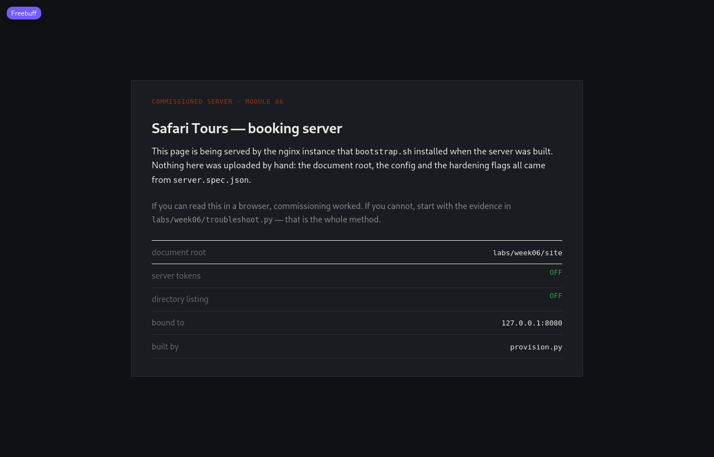

<div align="center">

# 06 · Commissioning and troubleshooting cloud servers

**A secure server takes two minutes. So does an insecure one.** The difference is whether the build is a
repeatable path or a hurried afternoon. This module builds a server from a spec through a policy gate, then
breaks it five ways and diagnoses each fault with evidence — on a real nginx, not a diagram.


[**Read the page →**](https://mmmmohammed.github.io/cloud-computing-security/module-06/) &nbsp;·&nbsp;
[← Module 05](../module-05/) &nbsp;·&nbsp;
[Portfolio](../)

</div>

---

## The commissioned server



*Captured in a browser from `http://127.0.0.1:8080/` after `provision.py` built it — not a mock-up. The page
is served by nginx, configured from `server.spec.json`, with `server_tokens off` and `autoindex off`.*

---

## What this module demonstrates

| Skill | Evidence in this folder |
|---|---|
| **Commissioning as a repeatable path** | A spec file, a six-check policy gate, a bootstrap script, a rendered config, and a verification request — 0.03 s from spec to a verified `200`, with a build record. |
| **Policy as code** | The gate is not advice: the insecure spec is refused, with the field named and the reason given, before anything is built. |
| **Systematic troubleshooting** | Five faults, each diagnosed by collecting the same evidence — status code, listener, `nginx -t`, error log — then fixed and re-tested with the request that failed. |
| **Operating knowledge that transfers** | The same symptom table applies to EC2: port blocked, service down, permission denied, dead upstream, wrong config. |

---

## What it builds on

| From | What came forward | Where it is used again |
|---|---|---|
| **Module 05** | Control-plane thinking: what a component's failure takes with it | The fault table in section 09 and the "what survives what" reasoning |
| **Module 04** | Every action is an authenticated API call | Why the metadata service is a credential endpoint, not a convenience |
| **Module 03** | Configuration is a security decision you own | `server_tokens off`, `autoindex off`, and the policy gate that enforces them |

---

## Check it in two minutes

| Look at | What it shows |
|---|---|
| [`labs/week06/provision.py`](../labs/week06/provision.py) | The gate, the render, the start, the verification |
| [`labs/week06/troubleshoot.py`](../labs/week06/troubleshoot.py) | Five real faults, injected and fixed |
| [`labs/week06/troubleshoot.log`](../labs/week06/troubleshoot.log) | The captured run quoted on the page |
| [`labs/week06/server.spec.bad.json`](../labs/week06/server.spec.bad.json) | The spec the gate refuses — run it and watch |

---

## The lab — commission, then break it on purpose

The sheet asks for an AWS Learner Lab instance. **That half is not run**: no security group through the API,
no instance, no console screenshots. What is run is everything that needs no account, against real software
on this machine.

**Substituted, and stated on the page:** a directory is the instance, the listen address is the security
group, and the "encrypted volume" is a flag the gate enforces rather than something `cryptsetup` did.

### Run it

```bash
cd labs/week06

python3 provision.py --spec server.spec.bad.json   # the gate refuses, nothing is built
python3 provision.py                               # builds and verifies, 6/6 checks
python3 provision.py --stop                        # stop the server

python3 troubleshoot.py                            # commissions inline, injects 5 faults, fixes each
```

Requirements: `nginx` on `PATH` (1.30 here), Python 3, port 8080 free.

### What the build produced

| Measure | Result |
|---|---|
| Policy checks | 6 of 6 passed (the bad spec fails 4) |
| Commission time | **0.03 s**, spec to verified response |
| Listening | 0.01 s after start |
| First request | **0.5 ms**, `200` |
| Build record | config SHA-256, tags, ports, timings — `runtime/build.json` |

### The five faults

| Fault | What the user sees | Evidence | After fix |
|---|---|---|---|
| Blocked | connection refused, process running | status `0`, listener on `127.0.0.9` | **200** |
| Service down | site unreachable | status `0`, nothing listening | **200** |
| Config error | will not start after a change | `emerg: unknown directive "worker_processes_on_holiday" … nginx.conf:31` | **200** |
| Permissions | 403 for a page that exists | status `403`, file mode `000` | **200** |
| Dead upstream | one route 502, rest fine | status `502`, `connect() failed (111 …) upstream 127.0.0.1:9099` | **200** |

Each fix was verified with the request that failed — not with a different test that happens to pass.

---

## How the page is built

- **The screenshot is real**: the page serves it from `module-06/img/`, captured at 1280 × 820 from the
  running server.
- **Code blocks are copied from the captured logs**, with absolute paths shortened by an ellipsis and
  nothing else altered.
- **Hand-written HTML and CSS**, one stylesheet and one script for the whole site. No framework, no build step.
- **Light and dark** through `prefers-color-scheme`; print stylesheet included.
- **No tracking, no cookies, no analytics.**

---

## Answer key

<details>
<summary>Five answers, so you can check yourself before clicking</summary>

| Question | Answer |
|---|---|
| 1 | D |
| 2 | B |
| 3 | D |
| 4 | A |
| 5 | C |

</details>

---

## Honest limits

- **No cloud was touched.** The AWS half — security groups, IAM role, IMDSv2, instance metadata, console
  screenshots — is unexercised. The page says so next to the part that was.
- **The substitutions are real but partial**: real nginx, real config parser, real file permissions, real
  refused TCP connection; no hypervisor, no network namespace, no encryption at rest.
- **Two screenshots failed.** I also tried to capture the "site down" Chromium error page and nginx's own 502
  page; both captured blank, so they are not shown and the faults rely on status codes and logs instead.
- Fault timings are local and small; the numbers describe this machine, not a production incident.

---

## Files

```
module-06/
├── index.html              the page — 3,565 words, 44 KB
├── README.md               this file
└── img/site-live.png       the commissioned server, captured in a browser

labs/week06/
├── server.spec.json        the declarative build: image, ports, tags, hardening flags
├── server.spec.bad.json    the same with four insecure values, for the gate to refuse
├── bootstrap.sh            the user-data equivalent, run once
├── provision.py            policy gate → bootstrap → render → start → verify → build record
├── troubleshoot.py         five faults, evidence collection, fixes, verification
├── provision.log           captured commissioning run
├── troubleshoot.log        captured fault suite
└── runtime/                generated: nginx.conf, logs, build.json (git-ignored)
```

---

<div align="center">

**[← Module 05](../module-05/)** &nbsp;·&nbsp; **[Portfolio](../)** &nbsp;·&nbsp; **[Read the page →](https://mmmmohammed.github.io/cloud-computing-security/module-06/)**

</div>
