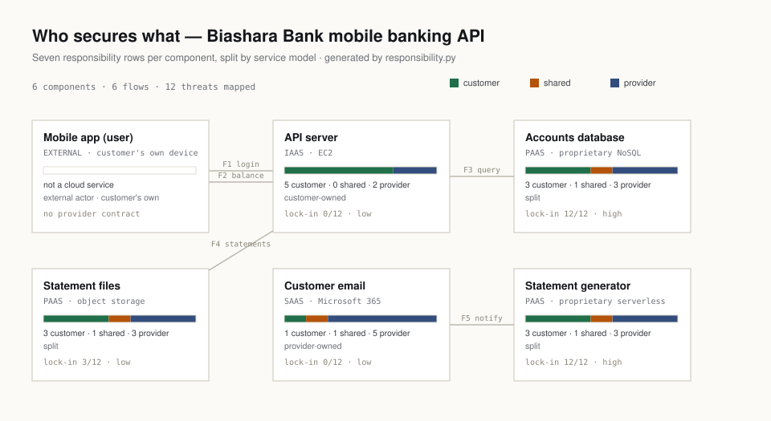

<div align="center">

# 07 · Cloud issues, challenges and provider lock-in

**The provider secures the cloud. You secure what you put in it.** This module turns that sentence into a
table you can compute, applies STRIDE to six data flows on a real architecture, and rehearses an exit from a
proprietary store instead of assuming one is possible.


[**Read the page →**](https://mmmmohammed.github.io/cloud-computing-security/module-07/) &nbsp;·&nbsp;
[← Module 06](../module-06/) &nbsp;·&nbsp;
[Portfolio](../)

</div>

---

## The generated diagram



*Produced by `labs/week07/responsibility.py` from `architecture.json`, not drawn by hand. Each box carries its
seven responsibility rows as a stacked bar, its service model, and its lock-in score out of twelve.*

> If the image above does not render in your viewer, open
> [`labs/week07/diagram.svg`](../labs/week07/diagram.svg) directly — it is the same file the page embeds.

---

## What this module demonstrates

| Skill | Evidence in this folder |
|---|---|
| **Applying the shared responsibility model** | The seven-row matrix encoded once, then applied per component: IaaS comes out 5/0/2, PaaS 3/1/3, SaaS 1/1/5. |
| **Threat modelling that produces owners** | Eleven STRIDE rules keyed to measurable properties of a flow; 12 threats, each with a CSA match, a control, and an owner derived from the matrix. |
| **Analysing lock-in** | Four dimensions scored 0–3 per component; the proprietary database and the proprietary function both reach 12/12, the portable components 0. |
| **Rehearsing an exit** | 4,000 records converted to CSV, JSON and SQLite with a matching SHA-256 over every field, plus a costed transfer. |

---

## What it builds on

| From | What came forward | Where it reappears |
|---|---|---|
| **Module 06** | Hardening is a checklist you run, not a paragraph you write | The policy-gate idea becomes a rule engine that admits what it cannot decide |
| **Module 05** | What a component's failure takes with it | Multi-tenancy risks: which ones you can retire with a change and which you can only watch |
| **Module 04** | Every cloud action is an authenticated API call | CSA threat #1 — identity, credentials, access and keys |

---

## The numbers

| Measure | Result |
|---|---|
| Components / flows analysed | 6 components, 6 data flows |
| Threats mapped | **12**, across 6 CSA categories |
| Who owns them | **9 customer** · 2 shared · 1 provider |
| Lock-in, Accounts database | **12/12 — high** (proprietary format, proprietary API, 60-month term, vendor-only skills) |
| Lock-in, Statement generator | **12/12 — high** |
| Lock-in, API server / email | 0/12 — low |
| Records recovered in the exit drill | **4,000 of 4,000**, identical SHA-256 in three formats |
| Egress cost for that volume | **$0.000104** at $0.09/GB — $0.00 under the 2024 waivers |

---

## Check it in two minutes

| Look at | What it shows |
|---|---|
| [`labs/week07/architecture.json`](../labs/week07/architecture.json) | The inputs: components with service models, flows with properties |
| [`labs/week07/responsibility.py`](../labs/week07/responsibility.py) | The model, the eleven STRIDE rules, the lock-in scoring, the SVG builder |
| [`labs/week07/report.json`](../labs/week07/report.json) | Every finding, machine-readable |
| [`labs/week07/responsibility.log`](../labs/week07/responsibility.log) | The captured run quoted on the page |
| [`labs/week07/exit_drill.log`](../labs/week07/exit_drill.log) | The exit rehearsal, with integrity proof |

---

## Run it

```bash
cd labs/week07

python3 responsibility.py      # model + STRIDE + CSA + lock-in -> report.json, diagram.svg
python3 exit_drill.py          # builds the stand-in store, exports 3 formats, verifies, costs
```

Requirements: Python 3 only. No packages, no account, no network.

The tools write `report.json`, `diagram.svg`, `responsibility.log`, the stand-in store and an `export/`
directory — all reproducible from `architecture.json`, so nothing in the repository is hand-edited output.

---

## What was and was not done

**Run:** the responsibility matrix, the STRIDE rule engine, the CSA mapping with derived owners, the lock-in
scoring, the SVG generation, and the exit rehearsal with per-format integrity checks.

**Not run:** anything against a real provider. No proprietary database was migrated, no egress was billed, no
contract was negotiated. The store is a local stand-in shaped like a vendor document table, and the price per
gigabyte is the published rate applied to a synthetic export.

The distinction matters for the exit drill in particular: it proves the *method* — normalise out of the
proprietary shape, write open formats, verify field by field, cost the transfer — not that any named vendor's
export is this clean.

---

## How the page is built

- **Hand-written HTML and CSS**, one stylesheet and one script for the whole site. No framework, no build step.
- **The diagram is generated**, embedded as SVG, and served from the repository rather than exported to a
  screenshot — so it stays sharp and stays honest about its source.
- **Code blocks are copied from the captured logs**, with absolute paths shortened and nothing else altered.
- **Light and dark** through `prefers-color-scheme`; print stylesheet included. No tracking, no cookies.

---

## Answer key

<details>
<summary>Five answers, so you can check yourself before clicking</summary>

| Question | Answer |
|---|---|
| 1 | A |
| 2 | C |
| 3 | D |
| 4 | C |
| 5 | A |

</details>

---

## Honest limits

- **The architecture is a teaching example**, not a real bank's design. Its flows were chosen to exercise the
  rules, and the rules were written to be decidable rather than exhaustive.
- **STRIDE coverage is property-based**: a threat appears when a flag is missing, so a flow with every flag set
  looks safe until someone adds a rule. That is a real limitation of checklist threat modelling.
- **DoS has no CSA 2022 entry**; the tool maps it to “insecure interfaces and APIs” and records the
  approximation instead of hiding it.
- **Sender authentication stays the customer's even in SaaS** — SPF/DKIM/DMARC are DNS, which the three-column
  model does not draw. One genuine edge case, documented rather than papered over.
- **Multi-tenancy risks are described, not tested**: no VM escape was attempted, and none should be.

---

## Files

```
module-07/
├── index.html              the page — 3,837 words
├── README.md               this file
└── diagram-preview.svg     the generated diagram, copied for GitHub rendering

labs/week07/
├── architecture.json       six components, six flows, lock-in attributes
├── responsibility.py       model + STRIDE + CSA mapping + lock-in + SVG
├── exit_drill.py           exit rehearsal with integrity checks and cost
├── responsibility.log      captured run
├── exit_drill.log          captured exit rehearsal
├── report.json             machine-readable findings
├── diagram.svg             generated diagram (embedded by the page)
├── proprietary_store.json  the stand-in store (regenerated on demand)
└── export/                 accounts.csv, accounts.json, accounts.sqlite
```

---

<div align="center">

**[← Module 06](../module-06/)** &nbsp;·&nbsp; **[Portfolio](../)** &nbsp;·&nbsp; **[Read the page →](https://mmmmohammed.github.io/cloud-computing-security/module-07/)**

</div>
